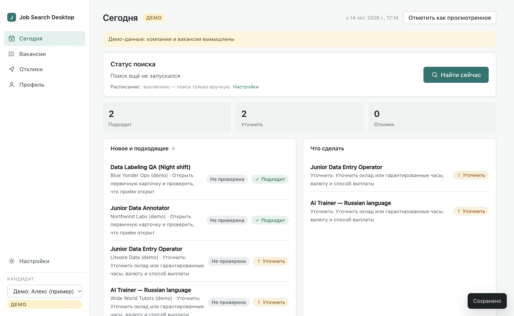

# Job Search Desktop

**Сам находит варианты и помогает понять, какие заслуживают твоего времени.**

Локальное desktop-приложение для macOS и Windows: один раз задаёте профиль, цели и ограничения — приложение регулярно собирает объявления из поддержанных источников, убирает дубли, проверяет условия, честно показывает неизвестное и помогает с документами и откликами. **Отправку отклика всегда выполняете вы.** Интерфейс на русском и английском.

> English summary is [below](#english).



## Что умеет

- **Онбординг без угадывания.** Цели (библиотека из 26 шаблонов направлений + свои), реальная страна/город/часовой пояс, формат (удалёнка/гибрид/офис), часы, языки письменно/устно, минимум оплаты по валютам, ограничения. У каждого условия — «обязательно / желательно / не задано». Неизвестное не подменяется предположением.
- **Сбор из реальных источников:** Jobicy, Remotive, Remote OK, Himalayas, Working Nomads, We Work Remotely (RSS), Хабр Карьера (RSS) и публичные доски компаний на Greenhouse / Lever / Ashby. Соблюдаются официальные лимиты: минимальный интервал опроса, пауза между страницами, повтор с backoff, `Retry-After`, отмена. Покрытие каждого источника видно (страницы, лимит на страницу, окно давности).
- **Политика исключённых источников.** hh.ru и бренды HeadHunter исключены в любой форме — прямые адреса, поддомены, зеркала, редиректы, ссылки внутри текста и импортируемых файлов. Список дополняется пользователем.
- **Единая функция решения.** Отдельные измерения: жизненный цикл объявления (открыто / закрыто / не подтверждено / не проверено), соответствие человеку (подходит / не подходит / уточнить), условия (страна, оплата, опыт, язык, звонки, часы, формат, безопасность) с цитатой-доказательством и статусом факта, рабочий этап человека и статус документа. Высокое совпадение не обходит жёсткий отказ или неизвестное; «Worldwide/EMEA» не доказывает найм из вашей страны; «до», оценка площадки и почасовая ставка без гарантированных часов не выполняют месячный минимум; часы пересчитываются в ваш часовой пояс с учётом перехода на летнее время.
- **Дедупликация с журналом:** ID источника → канонический URL → requisition ATS → осторожное сравнение компании+названия+локации+текста. Разные города и requisition не склеиваются; fallback-слияние обратимо кнопкой «Разъединить».
- **Наблюдения и история:** новое / изменилось / без изменений; история фактов и оценок; смена профиля создаёт новую версию и пересчитывает оценки, не переписывая прошлые.
- **Перепроверка первичной карточки:** 403/429/5xx/CAPTCHA/JS-оболочка/сеть не считаются закрытием; 404 и редирект на каталог хранятся отдельно от явного закрытия работодателем.
- **Отклики:** этапы (сохранено → готовлю → отправлено вручную → ответ → интервью → оффер / отказ / архив), чек-лист, напоминания, документы по версиям. «Открыть оригинал» не означает «отклик отправлен».
- **Документы:** импорт файлов (с проверкой доступности), черновики CV и писем **только из подтверждённых фактов** (шаблон без AI или AI), редактирование с версиями, сравнение версий, экспорт PDF/HTML/Markdown/TXT. Если работодатель запрещает AI-ответы, AI-генерация для этой заявки блокируется.
- **AI по делу:** извлечение требований в структурированный JSON с проверкой схемы и **проверкой, что каждая цитата действительно есть в тексте** (иначе факт отбрасывается). Провайдеры: Anthropic (официальный SDK) и любой OpenAI-совместимый (OpenAI, OpenRouter, локальные Ollama / LM Studio). Кэш по hash объявления+профиля+версии промпта+модели, месячный бюджет, журнал вызовов. Без AI работает всё, кроме AI-кнопок.
- **Локальное расписание:** ежедневно/еженедельно, пауза, следующий запуск, журнал пропусков, один догоняющий запуск после сна, защита от параллельного запуска, уведомления без повторов. **Это локальный таймер:** при выключенном компьютере поиск не идёт.
- **Данные у вас:** SQLite в папке пользователя, миграции с резервной копией, импорт CSV/JSON (экспорт Notion/Excel) и профилей с предпросмотром, транзакцией и откатом, повторный импорт без дублей, полный экспорт JSON, экспорт подборки в CSV. Ключи — в системном хранилище (Keychain/DPAPI).
- **Демо-режим** на вымышленных данных, явно помечен и никогда не смешивается с реальными кандидатами.

## Установка

| Платформа | Сборка | Статус |
|---|---|---|
| macOS Apple Silicon | `Job Search Desktop-0.1.0-arm64.dmg` | собрана и запущена локально; **не подписана и не нотаризована** |
| Windows x64 | NSIS-установщик из CI (`.github/workflows/ci.yml`) | конфигурация готова; на Windows ещё не запускалась |

Неподписанное приложение macOS при первом запуске: правый клик → «Открыть» (или `xattr -dr com.apple.quarantine "/Applications/Job Search Desktop.app"`). Подробнее — [docs/BUILD.md](docs/BUILD.md).

## Разработка

Требуется Node.js 22+ (проверено на 24/25).

```bash
npm ci
npm run typecheck
npm test            # 84 модульных/интеграционных теста (Vitest)
npm run build
npm start           # сборка и запуск Electron
npm run dev         # Vite + Electron с горячей перезагрузкой renderer
npm run e2e         # настоящее окно Electron на синтетических данных + скриншоты
npm run dist:mac    # dmg для Apple Silicon
npm run dist:win    # NSIS для Windows x64 (на Windows или в CI)
```

CLI с теми же функциями ядра: `node dist/cli.js run | reassess | import-profile <file> | import-vacancies <file> | ai-test | summary [--data <dir>]`.

## Архитектура

`src/shared` — типы · `src/core` — правила (факты, деньги, часовые пояса, география, классификация, дедупликация, решение, расписание) · `src/db` — SQLite (node:sqlite), миграции, репозиторий · `src/sources` — HTTP-клиент и адаптеры · `src/pipeline` — прогон поиска и перепроверка · `src/ai` — провайдеры, промпты, сервис · `src/importexport`, `src/docs`, `src/demo` · `src/main` — Electron main, IPC-API, воркер, preload · `src/renderer` — React-интерфейс. Подробности и решения — [docs/DECISIONS.md](docs/DECISIONS.md), источники — [docs/SOURCES.md](docs/SOURCES.md), дизайн — [docs/DESIGN.md](docs/DESIGN.md).

## Приватность

Все данные локальны. Сеть: только включённые источники, выбранный AI-провайдер (текст вакансии и выбранные факты — только по нажатию AI-кнопки) и страница вакансии при «Перепроверить». Приложение не отправляет отклики, письма и формы, не регистрирует аккаунты и не проходит тесты за пользователя. Ключи не попадают в renderer, журнал и экспорт.

## Чего нет (честно)

- Нет облачного исполнителя: расписание работает, только пока приложение запущено.
- Нет живой синхронизации с Notion (есть импорт CSV/JSON-экспорта).
- Нет DOCX-экспорта (есть PDF/HTML/MD/TXT); текст из PDF/DOCX при импорте не извлекается — файл хранится и открывается.
- Охват неполный: ленты отдают первые страницы/последние объявления; полный рынок не покрывается.
- Подпись кода/нотаризация не настроены.

## Лицензия

MIT — см. [LICENSE](LICENSE).

---

## English

**Finds options for you and helps you see which ones deserve your time.**

A local desktop app (macOS, Windows) with a Russian/English UI. Set your profile, goals and constraints once; the app collects postings from supported sources (Jobicy, Remotive, Remote OK, Himalayas, Working Nomads, We Work Remotely RSS, Habr Career RSS, Greenhouse/Lever/Ashby company boards) within their official rate limits, de-duplicates them with a reversible merge log, extracts facts with quoted evidence, and assesses each job **per candidate** with one decision function: hard constraints that fail → "does not fit"; hard constraints that are unknown → "clarify"; only fully confirmed → "fits". "Worldwide" never proves hiring from your country; "up to", platform estimates and hourly rates without guaranteed hours never satisfy a monthly minimum; working hours are converted to your time zone with DST. Lifecycle (open / closed / unconfirmed / not checked) is separate from fit; HTTP errors never count as employer closure.

Applications are tracked by stage with checklists, follow-ups and versioned documents. CV/letter drafts are built only from proven profile facts (template or AI); AI generation is blocked when the employer forbids AI-generated applications. AI (Anthropic via the official SDK, or any OpenAI-compatible endpoint incl. local Ollama/LM Studio) only extracts requirements into schema-validated JSON and every quote is verified against the posting text. Results are cached, budgeted and logged. Everything except AI buttons works without AI.

Data stays local (SQLite in the user profile, backups before migrations/imports, idempotent CSV/JSON import, JSON export). Keys are stored with the OS key store. hh.ru and HeadHunter brands are excluded in any form. The local scheduler only runs while the app is running. **You submit every application yourself.**

Build: `npm ci && npm test && npm run dist:mac` (or `dist:win`). The macOS build is unsigned; Windows packaging runs in CI and has not yet been launched on Windows. License: MIT.
