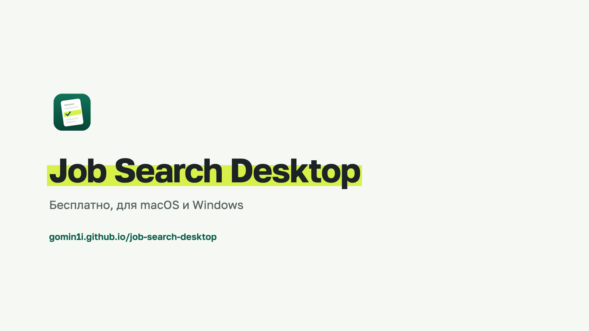
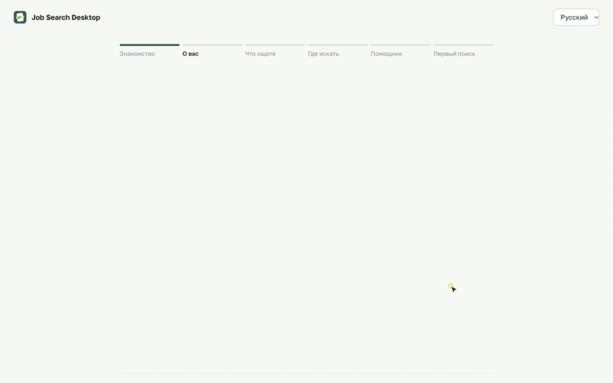
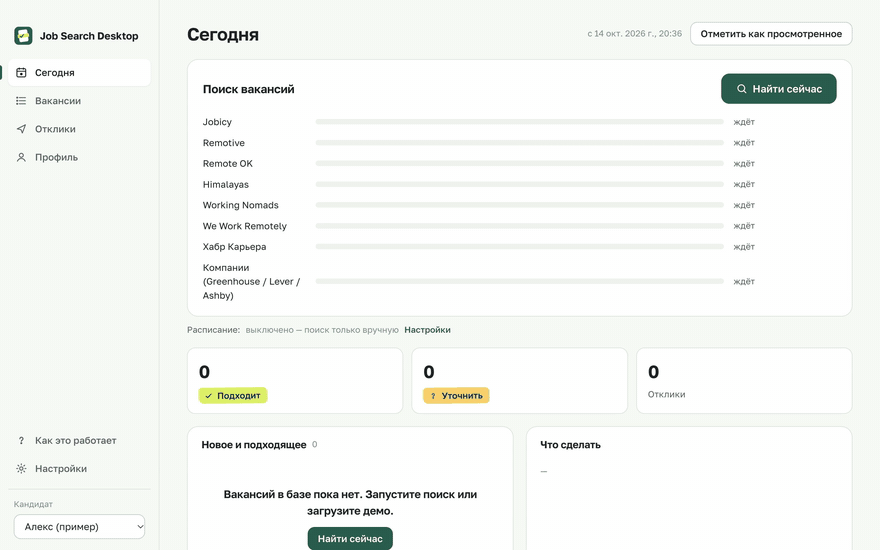
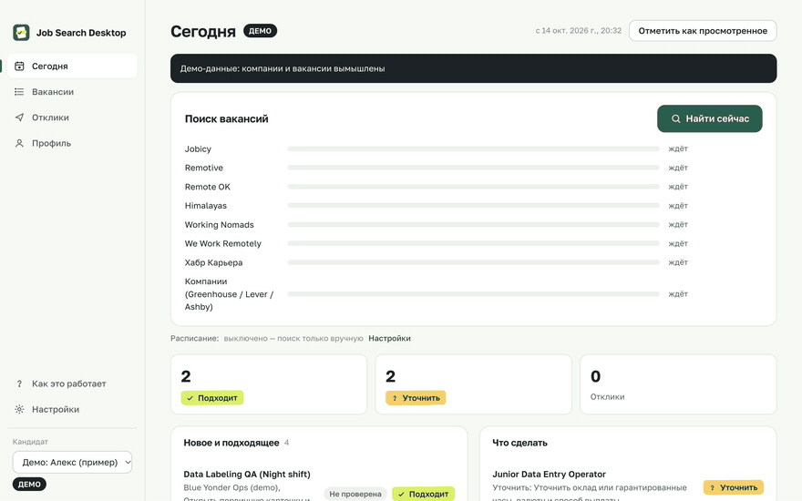
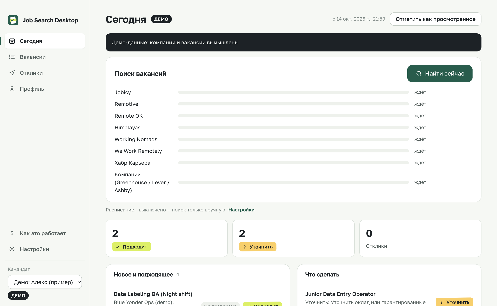
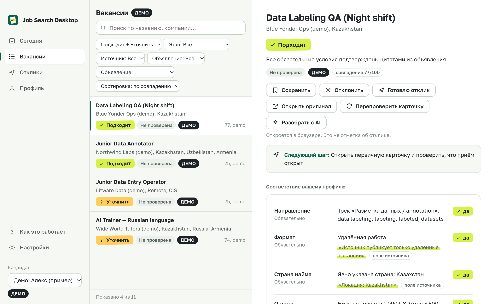
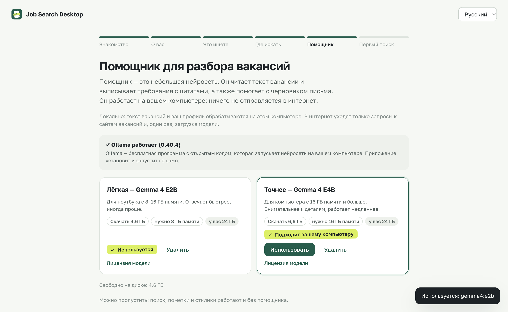
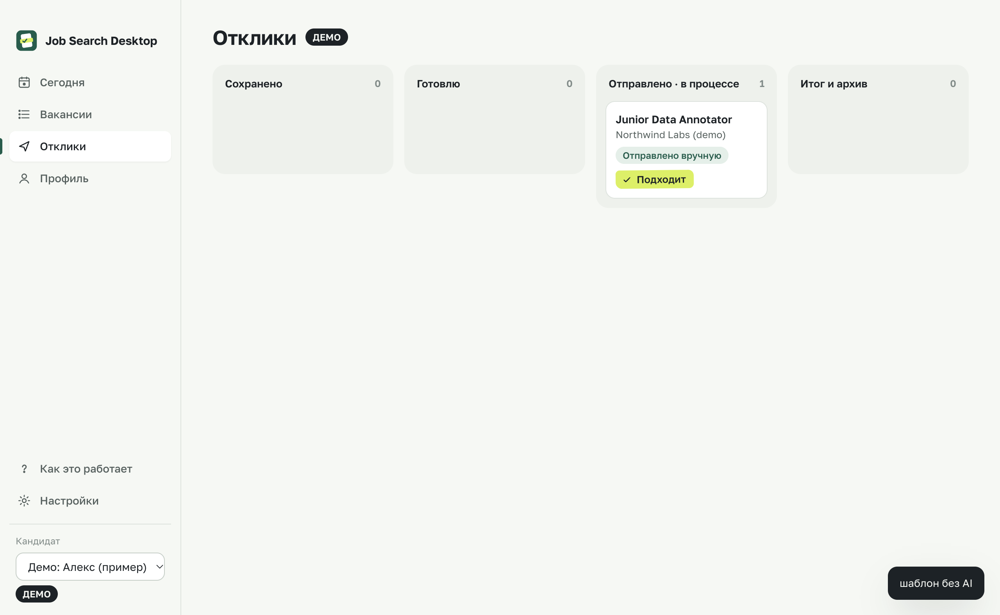

<p align="center"></p>

<h1 align="center">Job Search Desktop</h1>

<p align="center"><b>Находит вакансии и отмечает главное: что подходит, что уточнить, что нет.</b><br>
Бесплатное приложение для macOS и Windows. Интерфейс на русском и английском.</p>

<p align="center">
  <a href="https://github.com/GOMIN1I/job-search-desktop/releases/latest/download/Job-Search-Desktop-mac-arm64.dmg"><b>Скачать для macOS</b></a> (Apple Silicon)
  &nbsp;&nbsp;|&nbsp;&nbsp;
  <a href="https://github.com/GOMIN1I/job-search-desktop/releases/latest/download/Job-Search-Desktop-windows-x64-setup.exe"><b>Скачать для Windows</b></a> (x64)
  &nbsp;&nbsp;|&nbsp;&nbsp;
  <a href="https://gomin1i.github.io/job-search-desktop/">Сайт и ролик</a>
</p>

<p align="center"><a href="https://gomin1i.github.io/job-search-desktop/#film"></a></p>

> English version is [below](#english).

Вы один раз говорите, что вам подходит: страна, языки, направления, минимальная оплата, без звонков или со звонками. Приложение само обходит открытые сайты с вакансиями, убирает дубли и проверяет каждое объявление по вашим условиям. Каждый вывод подтверждён цитатой из текста. Если в объявлении чего-то нет, оно помечено «уточнить», а не угадано. Отклик всегда отправляете вы.

## Как это выглядит

| Настройка за пару минут | Настоящий поиск по сайтам | Разбор вакансии и отклик |
|---|---|---|
|  |  |  |
| Знакомство, о вас, что ищете, где искать | Запись реального запуска, ускорено | Демо-данные, вымышленные компании |

<table>
<tr>
<td></td>
<td></td>
</tr>
<tr>
<td></td>
<td></td>
</tr>
</table>

## Что умеет

- **Простой первый запуск.** Шесть шагов простыми словами: что делает приложение, о вас, что ищете, где искать, помощник (нейросеть), первый поиск и объяснение результатов. Есть «Назад», черновик сохраняется, любой шаг можно пропустить. Подсказки по экрану открываются снова из «Как это работает».
- **Поиск по открытым источникам:** Jobicy, Remotive, Remote OK, Himalayas, Working Nomads, We Work Remotely, Хабр Карьера и публичные доски компаний на Greenhouse, Lever и Ashby. Приложение соблюдает их лимиты и правила, прогресс по каждому сайту виден во время поиска.
- **Маркер вместо догадок.** Каждое условие отмечено: ✓ подходит, ? уточнить, ✕ не подходит. Цвет всегда дублируется значком и словом. «Worldwide» не считается доказательством найма из вашей страны, «до $1000» не выполняет минимум, часы пересчитываются в ваш часовой пояс.
- **Отклики под контролем.** Этапы, чек-лист перед отправкой, напоминания, черновики писем и резюме только из подтверждённых фактов вашего профиля, версии документов. Приложение ничего не отправляет само.
- **Нейросеть на вашем компьютере.** Ollama и модели Gemma ставятся прямо из настроек (подробнее ниже). Облачная модель тоже возможна, но не обязательна. Без нейросети работает всё, кроме кнопок «Разобрать с AI».
- **Данные у вас.** База SQLite в папке пользователя, резервные копии перед миграциями и импортом, импорт CSV/JSON, полный экспорт. Ключи облачных моделей хранятся в системном хранилище (Keychain/DPAPI).
- **Расписание.** Ежедневный или еженедельный поиск, пока приложение запущено (это локальный таймер: на выключенном компьютере поиск не идёт).
- **Демо-режим** на вымышленных данных, явно помеченный и отдельный от ваших.

## Установка

### macOS

1. Скачайте [Job-Search-Desktop-mac-arm64.dmg](https://github.com/GOMIN1I/job-search-desktop/releases/latest/download/Job-Search-Desktop-mac-arm64.dmg) и откройте его.
2. Перетащите приложение в «Программы».
3. Сборка пока не подписана сертификатом Apple, поэтому при первом запуске macOS его не откроет. Попробуйте открыть один раз, затем зайдите в «Системные настройки», раздел «Конфиденциальность и безопасность», и нажмите «Всё равно открыть».

Требования: macOS 13 или новее, Mac на Apple Silicon (M1 и новее). Сборки для Intel-Mac пока нет.

### Windows

1. Скачайте [Job-Search-Desktop-windows-x64-setup.exe](https://github.com/GOMIN1I/job-search-desktop/releases/latest/download/Job-Search-Desktop-windows-x64-setup.exe) и запустите.
2. Установщик не подписан, поэтому SmartScreen предупредит: нажмите «Подробнее», затем «Выполнить в любом случае».
3. Можно выбрать папку установки; ярлык появится в меню «Пуск».

Требования: Windows 10 или 11, 64-бит.

### Ресурсы

| | Само приложение | С локальной нейросетью |
|---|---|---|
| Память | около 450 МБ при работе | лёгкая модель: от 8 ГБ ОЗУ, точная: от 16 ГБ |
| Диск | около 400 МБ | плюс Ollama (≈ 0,2 ГБ на Mac, ≈ 1,7 ГБ на Windows) и модель (4,6 или 6,6 ГБ) |
| Интернет | только для поиска вакансий | плюс однократная загрузка модели |

## Нейросеть: локально и бесплатно

В разделе «Настройки», вкладка «AI» (и на шаге «Помощник» первого запуска):

| Модель | Загрузка | Нужно памяти | Кому подходит |
|---|---|---|---|
| **Лёгкая:** Gemma 4 E2B (`gemma4:e2b`) | ≈ 4,6 ГБ | от 8 ГБ ОЗУ | ноутбуки, быстрее отвечает |
| **Точнее:** Gemma 4 E4B (`gemma4:e4b`) | ≈ 6,6 ГБ | от 16 ГБ ОЗУ | точнее с деталями, медленнее |

- Перед загрузкой показан размер, требования к памяти, ваша память и свободное место на диске. Приложение рекомендует модель под ваш компьютер. Ничего большого не скачивается без вашего нажатия и подтверждения.
- Во время загрузки видны прогресс и скорость. Загрузку можно остановить и продолжить с того же места. Ошибки объясняются простыми словами.
- После загрузки модель проверяется настоящим разбором тестовой вакансии и только затем включается. Модель можно удалить одной кнопкой.
- Если Ollama ещё не установлена, приложение скачивает официальный установщик с GitHub-релиза Ollama и проверяет его контрольную сумму SHA-256. На Mac Ollama распаковывается в `~/Applications` и запускается; на Windows открывается официальный установщик.

**Что остаётся на компьютере:** при локальной модели текст вакансий и ваш профиль обрабатываются только на вашем компьютере. В интернет уходят лишь запросы к сайтам с вакансиями и однократная загрузка Ollama и модели. Облачная модель (Anthropic или любой OpenAI-совместимый сервис) включается отдельно, по вашему ключу.

Замер на 5 реальных вакансиях (MacBook Pro M4 Pro, 24 ГБ): E2B вернула корректный разбор в 4 случаях из 5, в среднем за 12,6 с; E4B вернула корректный разбор во всех 5, в среднем за 24,6 с. Интерфейс во время разбора не тормозит: клик обрабатывается за 25 мс. Данные замера лежат в `artifacts/`.

## Что проверено, а что нет

- **macOS (Apple Silicon):** `.dmg` скачан из релиза по ссылке выше, смонтирован и проверен; автотесты окна (E2E) против приложения из него пройдены на русском и английском (24 из 24); замерена производительность. Установка Ollama и загрузка модели проверены на настоящем движке: остановка на 35 %, продолжение, проверка, удаление.
- **Windows:** установщик собирается в GitHub Actions на `windows-latest`; там же E2E против собранного приложения (23 из 23; шаг с настоящей моделью пропущен, на сервере нет Ollama) и замер производительности. На физическом компьютере с Windows установщик вручную не запускался, установка Ollama на Windows не проверялась.
- Сборки не подписаны и не нотаризованы.

## Чего нет

- Облачного сервера нет: поиск по расписанию идёт, только пока приложение запущено.
- Охват неполный: ленты отдают последние объявления, а не весь рынок.
- Нет экспорта в DOCX (есть PDF, HTML, Markdown, TXT); текст из импортированных PDF/DOCX не извлекается.
- hh.ru и сервисы HeadHunter не используются ни в каком виде.

## Разработка

Нужен Node.js 22 или новее (проверено на 24 и 25).

```bash
npm ci
npm run typecheck
npm test
npm start
```

| Команда | Что делает |
|---|---|
| `npm run dev` | Vite и Electron с горячей перезагрузкой интерфейса |
| `npm run e2e` | настоящее окно Electron на синтетических данных, скриншоты в `docs/screenshots/` |
| `npm run dist:mac` | `.dmg` для Apple Silicon |
| `npm run dist:win` | NSIS-установщик для Windows x64 (на Windows или в CI) |
| `node scripts/perf.mjs` | замер времени запуска, памяти и отклика интерфейса |
| `node scripts/record-demos.mjs <папка>` | запись демо-видео для сайта и ролика |
| `node dist/cli.js run \| reassess \| ai-bench \| ollama-selftest \| summary` | те же функции из командной строки |

Структура: `src/core` (правила и решение), `src/db` (SQLite), `src/sources` (адаптеры сайтов), `src/pipeline` (поиск), `src/ai` (модели), `src/main` (Electron, IPC, Ollama), `src/renderer` (интерфейс на React). Ролик собирается из `film/` (Remotion, музыка синтезируется на numpy, мастер в ffmpeg: `bash film/make_film.sh`). Сайт лежит в `site/` и публикуется на GitHub Pages.

Документация: [дизайн](docs/DESIGN.md), [сборка и подпись](docs/BUILD.md), [источники](docs/SOURCES.md), [решения](docs/DECISIONS.md), [статус](IMPLEMENTATION_STATUS.md).

## Приватность

Все данные хранятся локально. Приложение ходит в сеть только к включённым сайтам с вакансиями, к выбранной модели (если она облачная) и к странице вакансии, когда вы нажимаете «Перепроверить». Оно не отправляет отклики, письма и формы, не регистрирует аккаунты и не проходит тесты за вас.

## Лицензия

Код: MIT, см. [LICENSE](LICENSE). Шрифт Golos Text: SIL OFL 1.1. Модели Gemma распространяются на условиях [Gemma Terms of Use](https://ollama.com/library/gemma4); Ollama: MIT.

---

## English

**Finds jobs and marks what matters: what fits, what to clarify, what doesn't.** A free desktop app for macOS and Windows with a Russian and English interface.

Downloads: [macOS (Apple Silicon)](https://github.com/GOMIN1I/job-search-desktop/releases/latest/download/Job-Search-Desktop-mac-arm64.dmg), [Windows x64](https://github.com/GOMIN1I/job-search-desktop/releases/latest/download/Job-Search-Desktop-windows-x64-setup.exe), [website and film](https://gomin1i.github.io/job-search-desktop/).

Tell the app once what works for you: country, languages, job areas, minimum pay, calls or no calls. It checks open job sites (Jobicy, Remotive, Remote OK, Himalayas, Working Nomads, We Work Remotely, Habr Career, and public Greenhouse, Lever and Ashby boards) within their limits, removes duplicates, and checks every posting against your rules. Each verdict is backed by a quote from the posting; anything the posting doesn't say is marked "clarify" instead of guessed. You always send applications yourself.

- **First run in six plain steps,** with back, saved progress, skippable steps, and an on-screen tour you can reopen.
- **Local AI, free:** install Ollama and Gemma 4 E2B (≈ 4.6 GB, 8 GB RAM) or E4B (≈ 6.6 GB, 16 GB RAM) from inside the app. You see size and requirements first, get a recommendation, and confirm before anything large downloads. Progress, pause and resume, verification, and removal are built in. With a local model, posting text and your profile never leave your computer. Cloud models (Anthropic or any OpenAI-compatible API) are optional.
- **Install on macOS:** open the `.dmg`, drag the app to Applications. The build is not signed yet: open it once, then go to System Settings, Privacy & Security, and click Open Anyway. Requires macOS 13+ on Apple Silicon.
- **Install on Windows:** run the installer; SmartScreen will warn because it is unsigned: click More info, then Run anyway. Requires Windows 10 or 11, 64-bit.
- **Verified:** the released macOS `.dmg` was downloaded, mounted and passed E2E tests in RU and EN (24/24), with performance measured. The Windows build and E2E tests (23/23) run on GitHub Actions `windows-latest`; the installer has not been run on a physical Windows PC, and installing Ollama on Windows has not been tested.

Development: `npm ci && npm test && npm start`. License: MIT.
